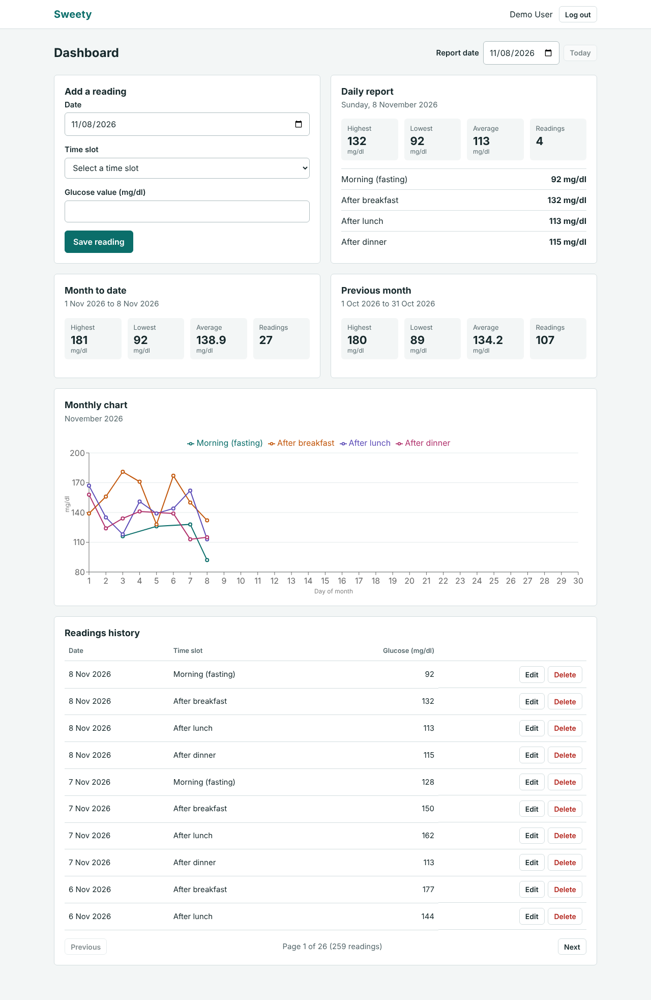

# Sweety – Blood Glucose Tracker

Sweety lets a person record up to four blood glucose readings a day (morning fasting, after breakfast, after lunch, after dinner), review their history, and see daily, month-to-date and previous-month reports with a monthly line chart.



## Tech stack

| Part | Technology |
| --- | --- |
| Frontend | React 19, Vite, JavaScript, plain CSS, Recharts, React Router |
| Backend | Node.js 22, Express 5, `pg` (parameterized SQL), JWT (`jsonwebtoken`), `bcrypt` |
| Database | PostgreSQL 16 |
| Tests | Jest + Supertest (backend), Vitest + React Testing Library (frontend) |
| Deployment | Docker Compose (PostgreSQL + backend + frontend served by nginx) |

## Project structure

```
sweety/
├── docker-compose.yml
├── .env.example               # every environment variable, no secrets
├── backend/
│   ├── Dockerfile
│   ├── src/
│   │   ├── app.js             # Express app (no listen, so tests can import it)
│   │   ├── server.js          # starts the HTTP server
│   │   ├── config.js          # reads and checks environment variables
│   │   ├── db/                # pool.js, schema.sql, migrate.js, seed.js
│   │   ├── middleware/        # auth.js (JWT), errorHandler.js
│   │   ├── routes/            # auth.js, readings.js, reports.js
│   │   └── utils/             # validation.js, dates.js, errors.js
│   └── tests/                 # auth, readings, reports, validation, dates
├── frontend/
│   ├── Dockerfile, nginx.conf
│   └── src/
│       ├── api/client.js      # fetch wrapper that adds the JWT
│       ├── context/           # AuthContext
│       ├── pages/             # Login, Register, Dashboard
│       ├── components/        # ReadingForm, ReadingsHistory, reports, chart
│       ├── utils/             # validation, dates, chart data, useFetch
│       └── test/              # React Testing Library + unit tests
└── docs/                      # demo script and screenshots
```

## Option 1: run everything with Docker

Requires Docker with Docker Compose.

```bash
cp .env.example .env          # then edit JWT_SECRET and POSTGRES_PASSWORD
docker compose up --build
```

Open **http://localhost:8080**. The database tables are created automatically when the backend starts. Database files are kept in the `pgdata` volume, so data survives `docker compose down` (use `docker compose down -v` to delete it).

Load the demo account and sample readings:

```bash
docker compose exec backend npm run seed
```

> Keep the PostgreSQL password free of characters such as `@`, `:` or `/`, because it is placed inside a connection URL.

## Option 2: run locally

Requires Node.js 20+ and PostgreSQL 14+.

### 1. Create the databases

```bash
psql -U postgres -c "CREATE USER sweety WITH PASSWORD 'change_me';"
psql -U postgres -c "CREATE DATABASE sweety OWNER sweety;"
psql -U postgres -c "CREATE DATABASE sweety_test OWNER sweety;"   # used only by the backend tests
```

### 2. Configure the environment

```bash
cp .env.example .env
```

Edit `.env` so the passwords in `DATABASE_URL` and `TEST_DATABASE_URL` match the one you chose, and set `JWT_SECRET` to a long random string (for example `openssl rand -hex 32`). `.env` is git-ignored.

| Variable | Purpose |
| --- | --- |
| `POSTGRES_USER`, `POSTGRES_PASSWORD`, `POSTGRES_DB` | Database credentials (used by Docker Compose) |
| `DATABASE_URL` | Connection string used by the backend |
| `TEST_DATABASE_URL` | Separate database for tests. Its tables are wiped on every test run |
| `JWT_SECRET` | Secret used to sign tokens (required) |
| `JWT_EXPIRES_IN` | Token lifetime, default `1d` |
| `PORT` | Backend port, default `5000` |
| `CORS_ORIGIN` | Allowed browser origin, default `http://localhost:5173` |
| `APP_TIMEZONE` | Time zone that decides what "today" is for the future-date rule |

### 3. Start the backend

```bash
cd backend
npm install
npm run db:migrate     # creates the tables (safe to run again)
npm run seed           # optional: demo user + sample readings
npm run dev            # http://localhost:5000
```

### 4. Start the frontend

```bash
cd frontend
npm install
npm run dev            # http://localhost:5173 (proxies /api to the backend)
```

### Demo account

After running the seed script:

- Email: `demo@sweety.app`
- Password: `Demo@1234`

The seed creates about 250 readings covering the last 75 days, so the daily, month-to-date, previous-month reports, chart and pagination are all populated. Running it again resets the demo user's readings.

## Running the tests

```bash
cd backend  && npm test    # needs PostgreSQL and TEST_DATABASE_URL
cd frontend && npm test
```

- **Backend (87 tests):** authentication, password hashing, duplicate emails, every validation message, duplicate slots, the 4-per-day limit, editing without self-conflict, user isolation, pagination, report maths and date boundaries (month ends, leap year, January to December), and the database constraints themselves.
- **Frontend (26 tests):** the reading form (required value, invalid values such as 39, 601, 120.5 and `abc`, boundaries 40 and 600, future date, duplicate slot, full day, editing, server errors) plus date, chart and registration helpers.

## API

All routes are under `/api`. Everything except register, login and health needs the header `Authorization: Bearer <token>`.

| Method | Path | Description |
| --- | --- | --- |
| POST | `/auth/register` | Create an account (`name`, `email`, `password`) |
| POST | `/auth/login` | Log in, returns `{ token, user }` |
| GET | `/auth/me` | Current user |
| GET | `/readings?page=1&limit=20` | Paginated readings, newest day first. Optional `date=YYYY-MM-DD` filter |
| GET | `/readings/:id` | One reading |
| POST | `/readings` | Add a reading (`reading_date`, `time_slot`, `glucose_value`) |
| PUT | `/readings/:id` | Edit a reading |
| DELETE | `/readings/:id` | Delete a reading |
| GET | `/reports/daily?date=` | Highest, lowest, average, count and the day's readings |
| GET | `/reports/month-to-date?date=` | 1st of the month up to and including `date` |
| GET | `/reports/monthly?date=` | The whole calendar month before `date`'s month |
| GET | `/reports/chart?month=YYYY-MM` | All readings in a month, for the chart |

`time_slot` is one of `morning`, `after_breakfast`, `after_lunch`, `after_dinner`. `date` defaults to today.

The list endpoint returns:

```json
{
  "data": [{ "id": 12, "reading_date": "2026-11-08", "time_slot": "morning", "glucose_value": 92, "created_at": "...", "updated_at": "..." }],
  "pagination": { "page": 1, "limit": 20, "total": 259, "totalPages": 13 }
}
```

Errors always look like `{ "message": "...", "errors": { "field": "..." } }`. `page` must be a whole number of 1 or more, and `limit` a whole number from 1 to 100; otherwise the API answers `400`.

## Validation rules

Checked in the browser for quick feedback and again in the API, which is the source of truth.

| Rule | Message |
| --- | --- |
| Value required | Please enter a glucose value. |
| Whole number from 40 to 600 | Value must be between 40 and 600 mg/dl. |
| One reading per slot per day | You already have an [slot] reading for this date. |
| At most 4 readings per day | You can add only 4 readings per day. |
| Date not in the future | Date cannot be in the future. |

## Database design

```
users                          readings
-----                          --------
id            SERIAL PK        id             SERIAL PK
name          VARCHAR(100)     user_id        INTEGER  FK -> users(id) ON DELETE CASCADE
email         VARCHAR(255) UQ  reading_date   DATE
password      VARCHAR(255)     time_slot      VARCHAR(20)  CHECK in the 4 slots
created_at    TIMESTAMPTZ      glucose_value  INTEGER      CHECK 40..600
                               created_at, updated_at  TIMESTAMPTZ
                               UNIQUE (user_id, reading_date, time_slot)
```

- `reading_date` is a plain `DATE`, and the driver is configured to return it as a `'YYYY-MM-DD'` string. No time zone conversion ever touches a reading's day, which avoids off-by-one errors at month boundaries.
- The `UNIQUE` constraint stops duplicate slots even if two requests arrive at the same moment. Because the slot list is also restricted by a `CHECK`, it also makes it impossible to store more than 4 readings per user per day.
- The unique constraint's index starts with `(user_id, reading_date)`, so it also serves the history and report queries; no extra index is needed.
- Deleting a user deletes their readings (`ON DELETE CASCADE`).
- Every query that touches readings filters by the `user_id` from the verified JWT. A `user_id` sent by the client is ignored.

## Recording the demo

See [docs/DEMO_SCRIPT.md](docs/DEMO_SCRIPT.md) for a 2–3 minute walkthrough script. Screenshots are in [docs/screenshots](docs/screenshots).

## Notes

### Assumptions

- **API prefix:** routes are served under `/api` (for example `GET /api/readings?page=1&limit=20`), which lets nginx and the Vite dev server send API traffic to the backend with one rule.
- **"Today":** the future-date check uses `APP_TIMEZONE` on the server (the browser's local date is used for the date picker's `max`). If the two differ, a reading near midnight may be accepted by the browser and rejected by the server; the server's answer is final.
- **Order of the two day rules:** when a day already has 4 readings, the "only 4 readings per day" message is shown rather than the duplicate-slot message, since it is the more useful explanation. With one to three readings, a repeated slot gets the duplicate message.
- **Message wording:** the duplicate message uses "a" or "an" to match the slot name ("an after lunch reading", "a morning (fasting) reading").
- **Reports** accept any valid date; a future date simply returns an empty report. The "monthly" report is always the previous calendar month relative to the selected date, and the chart shows the month of the selected date with one line per time slot.
- Averages are rounded to one decimal place by PostgreSQL (`ROUND(AVG(...), 1)`).
- Emails are stored in lower case, so `A@x.com` and `a@x.com` are the same account. Passwords must be 8 to 72 characters (bcrypt ignores anything beyond 72 bytes).
- The login token is kept in `localStorage` and lasts one day. An expired token sends the user back to the login page.
- The frontend history shows 10 readings per page; the API default is 20 and the maximum 100.
- Deleting a reading asks for confirmation using the browser's standard dialog.

### Possible improvements

- Store the token in an `httpOnly` cookie, add refresh tokens, rate-limit login attempts and add `helmet`.
- Use a migration tool (for example `node-pg-migrate`) once the schema needs to change.
- Add browser end-to-end tests (Playwright) and a GitHub Actions workflow that runs both test suites.
- Split the chart library into a lazily loaded chunk to shrink the initial JavaScript bundle.
- Highlight target ranges on the chart, support mmol/L, export readings to CSV and add notes to readings.
- Let each user choose a time zone, and add password reset by email.
